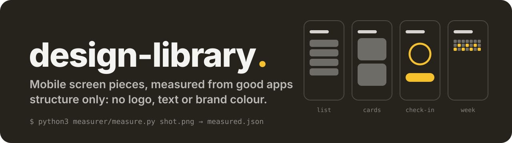

  

# design-library

Mobile screen pieces, measured from good real apps.

Each piece keeps only the structure of a screen people already know works: what data it shows, its spacing, sizes,
type, corner radii, contrast, motion and how it behaves for touch and screen readers. No logo, text, brand colour or
image of the app it came from.

## What is in it

- `entries/mobile/<pattern>/<piece>/`: 76 phone pieces in 10 patterns (category rows, check-ins, details, feeds,
  forms, hero lists, lessons, openings, ranked lists, week lists). `entries/web/` has a few more for wider screens.
- `measurer/`: a script that reads a phone screenshot and writes its structure as JSON. See `measurer/README.md`.
- `CATALOG.md`: every piece with the kinds of app it fits and one line on what it shows. `python3 tools/catalog.py`
  writes it.
- `SOURCES.md`: the web component libraries looked at for techniques, with their licences.
- `scales.json`: the spacing scale the pieces use.

## One piece

| file | what it holds |
|---|---|
| `entry.json` | id, version, pattern, the kinds of app it fits, one line on what it shows |
| `piece.json` | the data it needs (slots), the design roles it uses (colour, type, size), its spacing scale, its actions, states and motion, and its accessibility rules |
| `samples/` | sample data that fills it |
| `history.jsonl` | its versions and what changed |

Design roles are names, not values (`textPrimary`, `accent`, `radiusControl`, `minTouch`), so a piece takes any
colour set or type scale.
